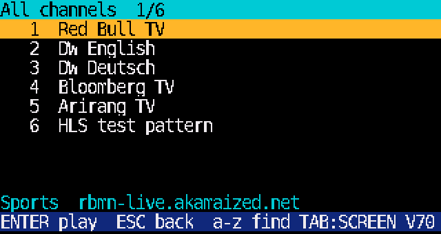
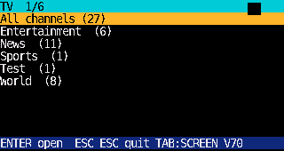
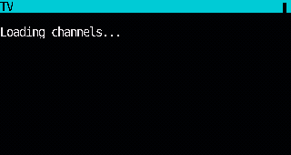
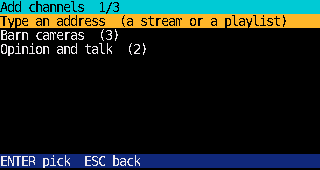

# cz-tv

A live TV guide for the **M5Stack Cardputer Zero**. Browse channels on the
card's own 320x170 screen, press ENTER, and it plays - on that same little
screen, or fullscreen on a TV the moment an HDMI cable is plugged in.




*Both of those are the card's own framebuffer, read off `/dev/fb0` on a stock
install with no config file.*



*The guide, type-to-search, and DW English decoding full-panel on the card's
own screen. Captured off `/dev/fb0` while the real binary was driven through a
uinput keyboard, so there is no desktop capture and no mock-up in it. The
full-length version is on the [v1.2 release](https://github.com/argosautomation/cz-tv/releases/tag/v1.2).*

Channels come from an ordinary **M3U playlist**, so it plays whatever you
already have: a Jellyfin or Plex playlist, an IPTV subscription, an iptv-org
list, or a text file of URLs you wrote yourself. It also ships with **27 free
live channels** built in, so it works the moment you install it - no account,
no config file, no server of mine or anyone else's in the path. The card
fetches the stream straight from the broadcaster's own CDN.

## What is interesting about it

- **Two displays, one app.** The guide lives on the SPI panel (`/dev/fb0`,
  fbdev) and the video goes to the vc4 HDMI out (labwc/Wayland). The app
  watches `/sys/class/drm/*HDMI*/status` every 2 seconds, so plugging a TV in
  **mid-show moves the picture to it** and unplugging brings it back, without
  touching a setting. TAB pins it either way.
- **Playback on the card itself.** With no TV at all, the stream is
  hardware-decoded by the VideoCore (`h264_v4l2m2m`), downscaled to 320x170 and
  blitted straight to the framebuffer. No compositor, no window.
- **It picks the rendition, not the player.** Players take the first variant a
  master playlist lists. cz-tv reads the master and takes the **smallest**
  rendition for the 320x170 panel and the **largest** for a TV, ranking by
  `RESOLUTION` where the playlist gives one and `BANDWIDTH` where it does not.
- **Sound follows the picture** - the HDMI sink for the TV, the onboard ES8389
  for the panel - and a title never starts inaudible.
- **Adding a channel needs no terminal.** **Add channels** is the last row on
  the home screen. It lists the packs the app ships with and any playlist
  already on the card - a USB stick, a file you copied over - so a channel is
  usually two keypresses, and an address can be typed in on the keypad if it is
  not. Same code as `cz-tv --add`, so both check a stream really plays before
  writing it down.
- **Small.** A static `aarch64-unknown-linux-musl` binary, **~500 KB**, two
  crates (`serde_json`, `libc`). Peak RSS on the card while playing: **under
  600 kB**. The HTTP is `curl` and the decode is `ffmpeg`/VLC, so the binary
  links no TLS stack at all.

## Install

```sh
sudo dpkg -i cz-tv_1.3-1_arm64.deb
sudo apt -f install        # pulls vlc, ffmpeg, curl and pulseaudio-utils
```

`dpkg` does not fetch dependencies, so on a card that does not already have VLC
the first line stops at *"dependency problems - leaving unconfigured"*. The
second line is what fixes it: it installs the four packages and finishes
configuring cz-tv. Run it even if the first line looked fine; it does nothing
when there is nothing to fix.

Or the same thing in one command, if your card is online when you install:

```sh
sudo apt install ./cz-tv_1.3-1_arm64.deb   # the ./ matters
```

It appears in the launcher as **TV**, and `cz-tv` is on your PATH.

*(In 1.2 it was not: the binary was installed where only the launcher looks, so
every `cz-tv` command answered "command not found" - which reads like being in
the wrong directory rather than like a packaging mistake. 1.3 ships a symlink
and upgrading fixes it.)*

## Keys

| key | in the guide | while playing |
|---|---|---|
| arrows / PgUp / PgDn / Home / End | move | - |
| ENTER | open / play | - |
| ESC | back (twice at the top = quit) | stop |
| TAB | where to play: follow the cable / SCREEN / TV | move the picture to the other screen |
| any letter or digit | search the whole lineup | - |
| BKSP | edit the search | - |
| Fn+S / Fn+D / Fn+A | volume down / up / mute (these are the desktop's own bindings, not the app's) | same |

## Adding channels

Channels **add up**. The built-in lineup is a starting point, not a thing you
have to replace: anything you point the app at is merged on top of it, so
adding one channel is one command - or two keypresses - and never a copy of the
whole list.

### In the app

**Add channels** is the last row on the home screen, under the groups.



*The real guide, drawn by the real binary: 320x170, read straight back out of
the framebuffer by `tests/cz_tv_ui_test.py`. Taken on a build host rather than
off the card's panel, so both of the lists it is offering are files in
`~/playlists`; on a card the first of them is the pack the `.deb` installed.*

It lists, in order of how little work they are:

| | |
|---|---|
| **a playlist already on the card** | the packs the `.deb` installs, and any `.m3u` in your home directory, `~/Downloads`, or a USB stick mounted under `/media` |
| **an address you type** | a single stream or a whole playlist, on the keypad |

Opening one of those playlists lists what is inside it, so you can take **all**
of it or **one channel** out of it - which is the point of a pack: a list of 40
regional channels is worth having even when only one of them is wanted.

Typing is last for a reason: the keypad has no shift key, so **TAB** is what
gives you capital letters, and the field starts at `https://` so that much is
already typed. A single stream is then offered a name, prefilled with its host,
and ENTER keeps it.

Either way the app checks the stream actually plays before it writes anything
down, says which file it wrote, and the new channels are in the guide when the
screen closes - no restart.

### From a shell

`cz-tv` is on PATH from 1.3 on, and does the same job with more control over
the name and the group:

```sh
cz-tv --add https://example.com/live/master.m3u8              # one stream
cz-tv --add https://example.com/live.m3u8 "Barn Cam" Cameras  # named, in a group
cz-tv --add https://someone.github.io/list.m3u                # a whole playlist
cz-tv --add ~/Downloads/my-channels.m3u                       # a file you have
cz-tv --sources                                               # where it all came from
cz-tv --probe                                                 # which ones still answer
```

`--add` fetches the thing first and **checks it plays** before writing anything
down. A single stream is appended to `~/.config/cz-tv/channels.d/my-channels.m3u`;
a remote playlist is recorded as a *subscription*, so it keeps tracking upstream
instead of freezing today's copy.

### Where the lineup comes from

Each source adds to the ones above it:

| | source |
|---|---|
| 1 | the built-in lineup (`"include_builtin": false` drops it) |
| 2 | `~/.config/cz-tv/channels.m3u` |
| 3 | `~/.config/cz-tv/channels.d/*.m3u`, alphabetically - where adding writes |
| 4 | `"playlist"` and `"playlists"` in `~/.config/cz-tv/config.json` |

**A later source wins on a channel name.** That is how you replace a built-in
channel whose feed has died, or point one at a better rendition, without
editing anything that the next package upgrade will overwrite - put the same
name and your URL in a drop-in file. The same URL arriving twice from two
overlapping lists is kept once.

```json
{
  "playlists": ["http://jellyfin.lan:8096/livetv/channels.m3u"],
  "include_builtin": false,
  "cache_secs": 21600
}
```

Fetched playlists are cached, so the guide still opens when the card is
offline. Groups in the guide come from `group-title`, channel numbers from
`tvg-chno` (merged lists are renumbered, and numbers somebody wrote down are
kept).

**Removing** channels is deleting the file the app names on the way in: one
file out of `~/.config/cz-tv/channels.d/`, and `cz-tv --sources` lists every
source it is reading.

### Packs

The package installs extra lineups in `/usr/share/cz-tv/packs/` that are **not**
in the guide until you ask for them. They are the first thing the **Add
channels** screen lists, or:

```sh
cz-tv --add /usr/share/cz-tv/packs/opinion.m3u
```

See [`channels/packs/README.md`](channels/packs/README.md) for what belongs in
one.

### Changing the player

`player` (TV) and `player_local` (the card's screen) are argv templates in the
same `config.json`; `{url}` is substituted, and `{vdec}` is the decoder from
`local_decoders`, tried in order until one keeps running. Neither needs a
rebuild. The defaults are `cvlc --fullscreen` and `ffmpeg ... -f fbdev
/dev/fb0`.

## Contributing a channel

The lineup is a data file - [`channels/builtin.m3u`](channels/builtin.m3u) - so
adding a channel for everybody is two lines in an M3U and no Rust at all. The
rules and the one check that matters are in
[CONTRIBUTING.md](CONTRIBUTING.md), and there are two tools in the repo:

```sh
tools/lint-channels.sh          # https, no credentials, no duplicates, 2 seconds
tools/check-channels.sh -o out  # fetch, decode a frame, build a contact sheet
```

Then **look at the contact sheet**. That is not a formality: a takedown slate
is clean H.264 + AAC with an HTTP 200, so it passes a reachability check, a
codec probe and a playlist parse. Running this on the two BBC channels in one
of the big community lists shows a Pluto *"That's a wrap!"* card; running it on
the old Pluto endpoint shows *"no longer available on this device"*. Nothing in
a terminal tells you that.

## Build

Cross-compiled on a normal x86-64 Linux box - **do not build on the card**, it
has 352 MiB of RAM.

```sh
rustup target add aarch64-unknown-linux-musl
cargo test                                      # 32 tests, no hardware needed
tests/cz_tv_add_test.sh                         # the guide itself, headless
packaging/build.sh                              # the static aarch64 binary

# the .deb, via the CardputerZero AppBuilder (MIT, cloned on the fly):
git clone --depth 1 https://github.com/CardputerZero/CardputerZero-AppBuilder.git /tmp/ab
/tmp/ab/scripts/pack-deb.sh . --output-dir dist
```

`.cargo/config.toml` points the musl linker at the toolchain's bundled
`rust-lld`, so no C cross-toolchain is needed.

Two tests drive the real binary rather than reasoning about it:

- `tests/cz_tv_add_test.sh` needs **no card and no root**. It runs the app with
  an ordinary file standing in for the framebuffer and a FIFO standing in for
  the keypad - both pointed at with the app's own
  `APPLAUNCH_LINUX_FBDEV_DEVICE` and `CZ_KBD` - types its way through adding a
  channel four different ways, and then checks the file the app wrote. It
  leaves a montage of every screen behind. `tests/cz_tv_ui_test.py` is the
  driver and takes a timeline of keys and `GRAB:`s of its own.
- `tests/cz_tv_hw_test.sh` is the on-card test: it drives the real app through
  a uinput keyboard and grabs `/dev/fb0` on a timeline, so the screenshots are
  read off the hardware.

## The built-in channels

27 channels, in five groups, all free, and all of them decoded a frame of real
programming on **2026-11-21** - checked with `tools/check-channels.sh` and the
contact sheet looked at:

| group | channels |
|---|---|
| News (11) | CBS News 24/7, NBC News NOW, LiveNOW from FOX, Scripps News, USA Today, Reuters, Cheddar, Bloomberg TV, Bloomberg Originals, WeatherNation, Global News Canada |
| World (8) | Al Jazeera English, DW English, DW Deutsch, CNA Singapore, India Today, SABC News, Arirang TV*, America TeVe |
| Sports (1) | Red Bull TV |
| Entertainment (6) | Retro TV, Heartland, Rev'n, Court TV, Drybar Comedy, Biz TV |
| Test (1) | Apple's HLS test pattern |

\* Arirang blanks some programmes with a rights card of its own; the rest of
its schedule plays.

On the last sweep, 27 of 27 answered and decoded. A few frames caught a
station's own ad break ("we'll be right back", with a countdown) rather than
programming, which is a live channel doing a normal thing, not a dead one. The
one picture to be suspicious of is a card that never changes, and the way to
tell them apart is to grab a second frame a minute later.

Every one is the publisher's own free ad-supported feed or a feed they
distribute through a FAST platform. Nothing here is a pay channel someone is
rebroadcasting, nothing needs a login, and no URL carries a credential.

**How they were picked.** 60-odd candidates were pulled from the public
free-stream lists, every one fetched, decoded and the resulting **frame looked
at**. 23 of them were dropped. That last step is not fussiness: this app
started as a Pluto TV client, and Pluto's open endpoint now answers every
client profile with a *"Pluto TV is no longer available on this device"* slate
instead of video. The slate is clean H.264 + AAC and it arrives with an HTTP
200, so a status check, a codec probe and a playlist parse all pass on a
channel that shows a dead card. Only a decoded picture catches it. The same
pass found ABC News Live, NASA TV, NHK World and CBS News's old Akamai URL
serving a **200 on the master playlist and a 404 on every variant inside it**.

Streams rot, so expect some of these to stop. `cz-tv --probe` re-checks the
whole lineup from the comfort of a desktop and names the dead ones, and
replacing one is a two-line edit in the M3U - nothing is compiled in that you
cannot override with your own playlist.
